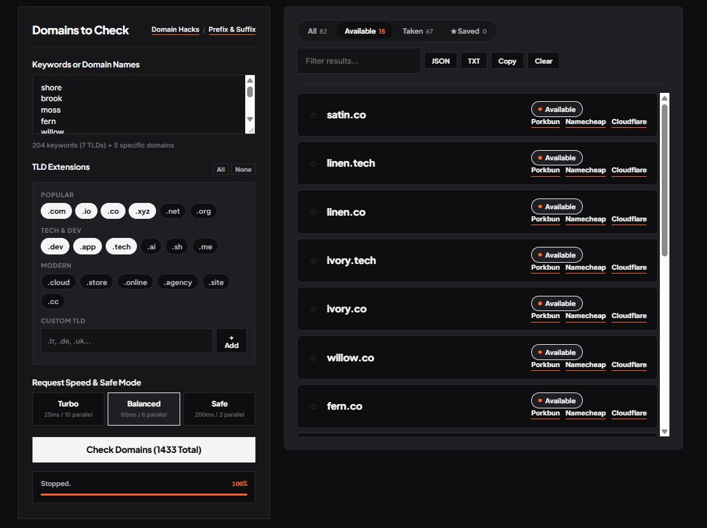
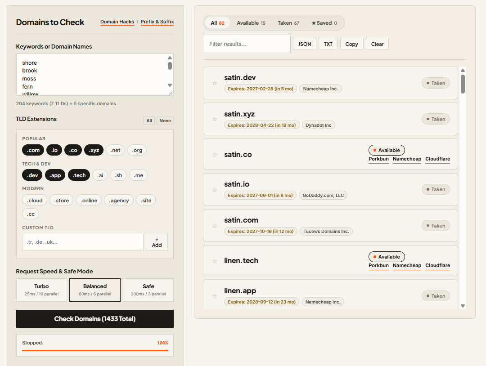

# Domain Checker

A lightweight, zero-dependency domain availability checker with an authoritative RDAP lookup engine.




---

## How It Works

1. **Zero Dependencies:** Built entirely with Python's standard library and vanilla web technologies. No `pip install` or external packages required.
2. **Authoritative RDAP Queries:** Directly queries official ICANN and registry RDAP endpoints (Verisign, Google Registry, PIR, CentralNic, Identity Digital, Radix, etc.) instead of guessing via DNS, with a WHOIS fallback for TLDs that have no public RDAP (.co, .de, .tr, etc.).
3. **Accurate Availability:** Identifies whether a domain is available (HTTP 404) or registered (HTTP 200) with registrar names and expiration dates.
4. **Self-Healing Rate Limits:** Automatically handles HTTP 429 rate limits with live backoff cooldowns and background retries.

---

## Features

- **Bulk Search:** Enter keywords or domains in any format (comma, space, or line-by-line).
- **Domain Hacks:** Detects word-ending extensions across 120+ TLDs (e.g. `radio` -> `rad.io`, `focus` -> `foc.us`, `studio` -> `stud.io`).
- **Prefix & Suffix Generator:** Generates startup brand variations using popular prefixes (`get`, `try`, `use`, `open`, `join`) and suffixes (`app`, `lab`, `labs`, `ai`, `hub`, `ify`).
- **Word Mix:** Adds random two-word names like `bluefox` from `public/words.json` to the input, 50 at a time.
- **Custom TLDs:** Add any custom extension (e.g. `.tr`, `.de`, `.uk`, `.gg`).
- **Registrar Links:** Direct search links for Porkbun, Namecheap, and Cloudflare.
- **Clean Export:** Download available domains as simple JSON, plain TXT, or copy directly to clipboard.
- **Discover:** Scans tech names, elegant words, easy names like `tuta`, single words of 4 to 8 letters and two-word pairs (`bluefox`) for free `.com` names through the `.com` DNS servers, most common first, and shows its reasoning live. Confirm a name with Verify before buying.
- **Alarms:** Watch a list of domains in the background, one query every 10 seconds, with automatic backoff on rate limits. Runs while the app is running and keeps the list in `alarms.db`.
- **Docker:** `docker compose up -d --build` runs it on port 8080 and keeps the data in `./data`. Add words and send them to the front of the queue from the Discover tab. Changes to `public/words.json` are added on restart, and nothing already found is lost. Set `DOMAIN_CHECKER_SCAN_DELAY` to change the scan speed.
- **Network Access:** Local only by default. Start with `DOMAIN_CHECKER_HOST=0.0.0.0 python3 app.py` to reach it from other devices. There is no login, so use this on trusted networks only.
- **Persistent Favorites:** Save favorite domains to browser localStorage.
- **Dark Mode:** Default high-contrast dark theme with an instant toggle.

---

## Quick Start

1. Clone the repository and navigate into the directory:

```bash
git clone https://github.com/LegessaLynx/domain-checker.git
cd domain-checker
```

2. Run the application:

```bash
python app.py
```

*(or `python3 app.py` on macOS/Linux)*

The server starts locally and automatically opens your default browser at:
`http://localhost:8080`

To stop the server, press `Ctrl + C` in the terminal.

---

## Word Sources

Word lists in `public/words.json` draw on [wordfreq](https://github.com/rspeer/wordfreq), [WordNet](https://wordnet.princeton.edu/), [Wiktionary](https://www.wiktionary.org/) via [kaikki.org](https://kaikki.org/) (CC BY-SA) and Webster's 1913 dictionary (public domain).

---

## Project Structure

```
domain-checker/
├── app.py          # Python HTTP server, RDAP proxy, alarm watcher and Discover scanner
├── Dockerfile      # Container image
├── docker-compose.yml
├── README.md       # Documentation
├── img/            # Screenshots (dark and light preview)
└── public/         # Frontend web application
    ├── index.html  # Application layout
    ├── style.css   # Stylesheet (dark default)
    ├── app.js      # Parser, queue engine, and UI controller
    └── words.json  # Starting word lists, loaded into the database
```

---

## License

MIT License. Free and open source.
